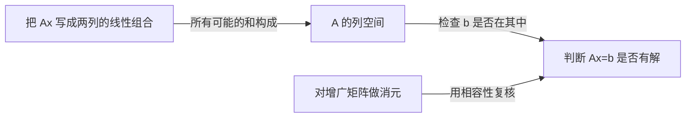

# E.S-V SKILL

[English](README.en.md) · [教学设计与参考项目](docs/design-notes.md) · [跨学科测试](docs/tests.md)

**一份从选书到闭卷作答的课程学习技能。** 给它老师的课件和指定教材，它会把这个领域里的知识传授给你，使你快速熟练掌握知识并独立解决相关领域问题。如果你的手上还没有资料，AI会按照提示为你提供一份按适合你的主题组织的候选书单，选定后再开始学习。

## 在你的智能体中开始

**普通聊天或自建智能体。** 下载 [E.S-V 通用单文件](E.S-V.portable.md)。将它作为附件或知识文件，并说“请按随附的 E.S-V 教我这门课”。仅支持文字输入时，把文件正文粘贴到对话或自定义指令中，再说出课程、起点和可用时间。文件内含完整教学流程、选材、导图、讲义与复习指南。可按文件中的标题分段粘贴。

**支持 Agent Skills 的工具。** 下载并复制整个 [e-s-v 技能目录](skills/e-s-v/) 到下表的位置，保持子目录结构。也可以用客户端自带的技能安装器。[Agent Skills 开放规范](https://agentskills.io/specification)

| 工具 | 使用方法 |
|---|---|
| Claude Code | 项目中放入 `.claude/skills/e-s-v/`，在会话中输入 `/e-s-v`。[官方说明](https://code.claude.com/docs/en/skills) |
| Gemini CLI | 项目中放入 `.gemini/skills/e-s-v/`。在会话中执行 `/skills reload` 和 `/skills list`，然后用自然语言请它使用 E.S-V。[官方说明](https://geminicli.com/docs/cli/skills/) |
| GitHub Copilot | 仓库中放入 `.github/skills/e-s-v/`，在支持 Agent Skills 的 Copilot Agent 环境里提出学习任务。[官方说明](https://docs.github.com/en/copilot/concepts/customizations/agent-skills) |
| Codex | 本机放入 `~/.codex/skills/e-s-v/`，新会话中输入 `$e-s-v`。也可以用下面的 Skills CLI 命令安装。 |

```sh
npx skills add longgongyu888-oss/E.S-V-SKILL --skill e-s-v -a codex -g
```

宿主能读图、浏览网页或创建文档时，技能会使用这些能力。纯文字环境也能给出带连线的导图、课程讲解、练习与答案。需要复核原图或链接时，讲义会留下具体位置。下面的提示可以直接对任何已加载 E.S-V 的助手说。

## 三种开始方式

**手上还没有课件**

> 请按 E.S-V 教我。我第一次学表观遗传学。先按主题推荐辅助书籍、综述、经典技术论文和公开课件，告诉我各项适合读哪里。等我选好，再给我全课导图，然后开始第一讲。

**已经选好老师的材料**

> 请按 E.S-V，用我上传的 PPT 和这本指定教材。我有五天复习。请按老师的重点写可独立阅读的 WPS 讲义，保留每个课件点的出处。难点配教材原图、通路图和短视频，再出一份有解析的变式题。

**知道自己错在哪里**

> 请按 E.S-V 辅导我。我会算特征值，却不会判断矩阵能否对角化。先让我做一道题，根据我的理由找出卡点，再换一个矩阵测我。

## 学习者会得到什么

| 阶段 | 具体产物 |
|---|---|
| 选择资料 | 带推荐理由和获取入口的候选清单，按课程主题显示基础覆盖、替代选项和进阶阅读。没有本班 PPT 时可选大学教师公开授课幻灯片。 |
| 开课前看全景 | 资料确定后先拿到一张可放大的学习框架图。图上标出先修、核心问题、章节联系、学习重点和学完能独立完成的任务，再进入第一课。 |
| 学懂一章 | 把关键问题、先修知识、推导、证据、例题放在同一条思路上。课堂手写重点辨认不清时，会定位到照片的具体位置请你核对。 |
| 看懂一幅图 | 从一条箭头、一个坐标或一组对照开始读，自己预测下一步。必要的教学视频就在这段讲解后，有观看任务和播放页。 |
| 验证掌握 | 先合上讲义做题，后看解析，找到出错的第一步。下一次复习会换条件、换材料，区分记住答案和能够迁移。 |

只复习一小节时，可以直接在对话中学。资料很多、需要脱离原书自学时，可生成主讲义、逐页伴读和练习册。受交付范围限制的试学单元会列明本次展开的章节。详细工作方式见[技能入口](skills/e-s-v/SKILL.md)。

## 看一个小例子

学线性代数时，可以从“方程什么时候有解”开始。把矩阵的两列写成 (1,2) 和 (2,4)，问学生右端向量 (3,6) 能否由这两列凑出来。



第一列取三份就得到 (3,6)，所以有解。两列都落在直线 y=2x 上，因此把右端换成 (3,7) 就无解。合上讲义，试把两列换成 (1,3) 和 (2,6)，判断 (4,11) 与 (4,12) 各是什么情形。能自己找出新的直线，再用消元复核，就有了这次学习的作答证据。[变式解析和其他学科实测](docs/tests.md)

## 原创与许可

这套方法从一次真实的分子生物学课程整理中提炼。仓库收录可复用的技能、教学设计和测试案例。用户提供的课件、教材与个人笔记保存在本机。原创内容使用 [MIT 许可证](LICENSE)。

维护时先修改 `skills/e-s-v/` 中的教学内容，再运行 `python scripts/build_portable.py` 更新通用单文件。`python scripts/build_portable.py --check` 可核对两个入口是否一致。
